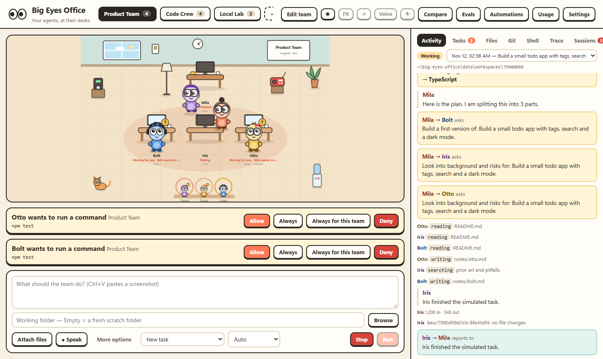
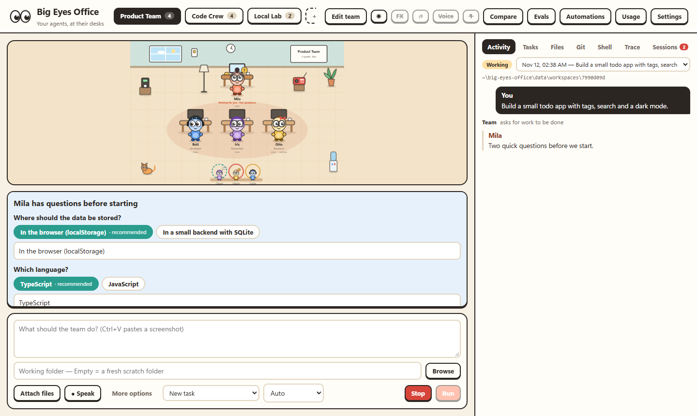
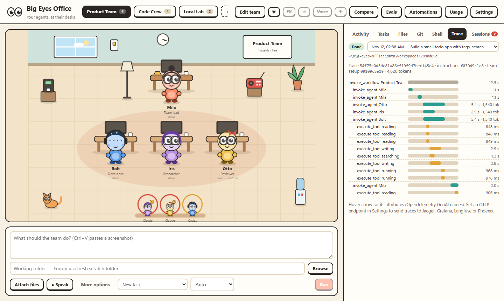
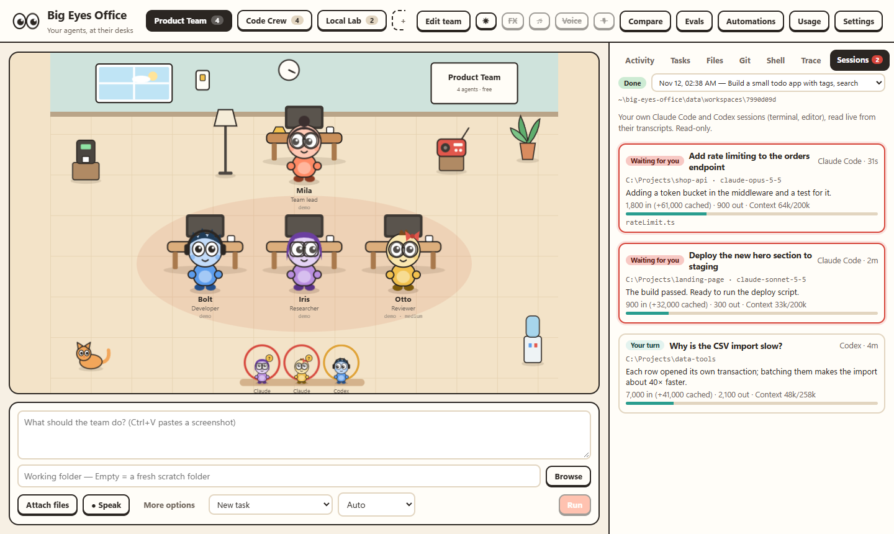
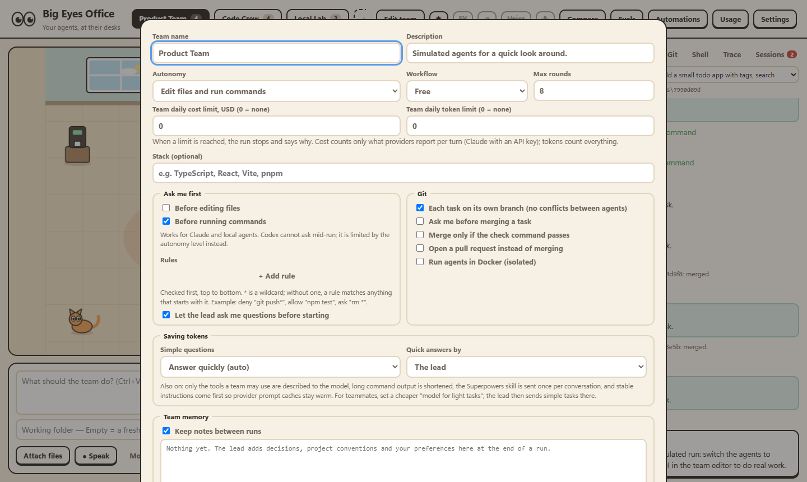
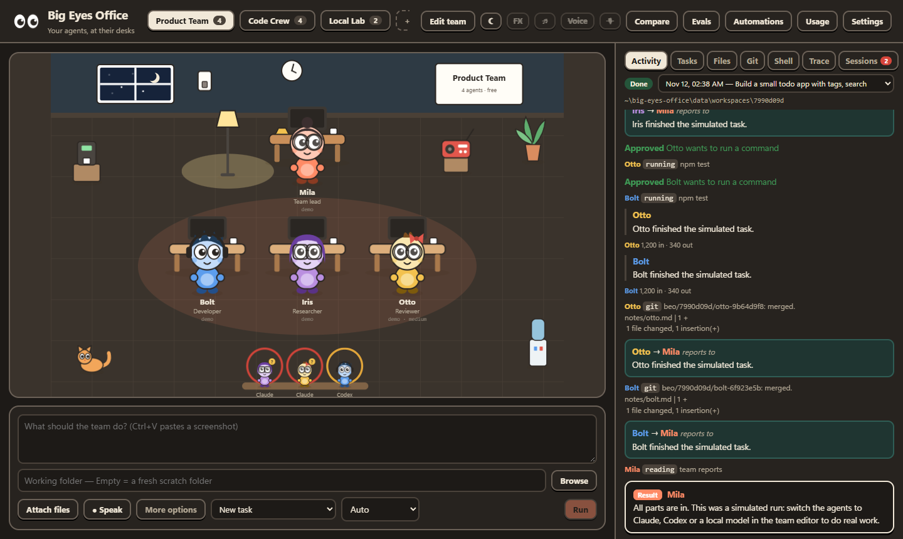

# Big Eyes Office

A local office of big-eyed AI agents. Build teams from Claude, Codex and local models, give them a task from the browser, and watch them work at their desks.

Everything runs on your own machine. The server listens on `127.0.0.1` only.



## What it does

- **Teams you save and switch between.** Each team has named agents with a role, provider, model, effort level, instructions and one of ten big-eyed characters. Create, edit, duplicate and delete teams and agents from the UI.
- **Mixed providers in one team.** A Claude lead can hand work to a Codex researcher and a local Qwen coder.
- **Live office.** Agents think, read, write, run commands and search at their desks, and walk over to each other when they delegate or report. Click a character to see its status, its terminal and to message it directly.
- **Named tasks with live status.** The Tasks tab shows one lane per agent: what each is working on, what is queued behind it, how long it has taken and which branch it is on.
- **No conflicts between agents.** In a git repository every delegated task gets its own branch and worktree and is merged when it finishes. Two tasks for the same agent queue up.
- **Rules per team, each a switch.** Ask me before edits, ask me before commands, ask me before merging, merge only if the check passes, open a pull request instead of merging.
- **Approvals without idle time.** An agent that needs your OK waits; the rest of the team keeps working.
- **Messages.** Talk to the whole team or to one agent, also while a run is going. Messages are delivered with the agent's next turn.
- **Fewer tokens.** Simple questions get one short answer from one agent with a few lines of instructions and no tools (Auto mode; the agent hands over to the team when it needs files). Teams describe only the tools they may use, send the Superpowers skill once per conversation, keep instructions stable for provider prompt caches, cap teammate reports and shorten long command output. Teammates can have a cheaper model for tasks the lead marks as light.
- **Context you can see.** Each agent shows how full its context window is (and what fills it, for Claude). Agents are compacted at 75% with their own summary, or on demand; "Start fresh" forgets a conversation. Local models compact themselves before they run out.
- **Parallel messages.** A message to a free teammate is answered right away, while the lead keeps working; the lead is told what was said.
- **Team memory.** The lead keeps short notes between runs (decisions, conventions, your preferences); you can read and edit them in the team editor.
- **MCP servers.** Give a team extra tools, such as Playwright for UI testing in a real browser. Works with Claude, Codex and local models.
- **Your own sessions.** Claude Code and Codex sessions you run yourself in a terminal or editor appear live in the Sessions tab and as visitors in the office, with their state (working, waiting for you), tokens, context and touched files. Read-only.
- **Desktop app.** `npm run desktop:build` makes a Windows installer: own window, tray icon, start with Windows, notifications, and Ctrl+Shift+Space for a new task.
- **Screenshots in the chat.** Paste an image with Ctrl+V (PrtSc, Win+Shift+S), drop files on the task box, or attach them. Images go to the model natively where it can see images (Codex, vision models in Ollama) and as files the agent can open otherwise (Claude reads them with its file tool).
- **Files, Git and Shell tabs.** Browse and upload files, read the uncommitted diff, commit, switch and merge branches, open and merge pull requests (through the `gh` CLI), and run your own commands in the working folder.
- **Automations.** Start a team on a cron schedule or from a webhook. A run is skipped while the previous one is still working.
- **Check loop.** If you set a check command such as `npm test`, the team is sent back to fix failures, up to 3 attempts.
- **Usage and history.** With the database on, every agent turn is recorded in SQLite: tokens, cost where the provider reports it, duration and failures, per model, per agent and per day, plus tasks done and failed per agent.
- **Optional stack per team**, passed to every agent.
- **Questions before work starts.** When a decision matters and is unclear, the lead asks you first, with suggested answers and its recommendation. A switch per team.
- **An office you can play with.** Drag desks and furniture, switch the lights (dark mode), pet the cat, start the coffee machine, turn on the radio.
- **Sound, music and voice.** Synthesized click and event sounds, three generative background tracks, dictation for the task box and spoken results. Each has its own switch. No audio files are shipped, so there is nothing to license.
- **Storage you choose.** JSON files by default; switch on SQLite in Settings to record usage, costs and task history.
- **Budgets.** Daily cost and token limits per team, and a token limit per agent. A run stops and says why when one is reached.
- **Resume after a restart.** Agent sessions (Claude sessions, Codex threads, local conversations) are stored with the run; a run cut off by a restart shows a Resume button.
- **Codex with approvals.** Codex agents run through `codex app-server`, so "ask me before commands / edits" works for them too, and their models are listed from Codex itself, also with a ChatGPT login.
- **Real billing.** With admin keys, the Usage screen shows actual costs from Anthropic and OpenAI; with a ChatGPT login it shows Codex plan limits.
- **Loop templates and GitHub triggers.** Issue triage, CI repair, dependency sweep, security burndown and error-alert templates; GitHub triggers poll new issues, pull requests or failed CI through `gh`, no tunnel needed.
- **Docker isolation.** A team can run its agents in locked-down containers: only the working folder is mounted, no Linux capabilities, read-only system, memory/CPU/process limits, and internet only through an allowlist proxy (providers, GitHub and package registries by default). On Windows and macOS, Docker Desktop adds its own VM around them.
- **No collisions.** Inside a run, every delegated task has its own branch and folder and merges happen one at a time per repository; between runs, a folder is shared only by runs whose teammates all use their own branches, others wait their turn.
- **Permission rules.** Allow, ask or deny commands and file edits by pattern per team, and save "always allow" for a team from the approval card.
- **Compare teams.** Give one task to several teams, each on its own branch; compare time, tokens, cost and the check, then merge the best.
- **Real terminal.** The Shell tab is a full terminal (PTY + xterm.js) when the prebuilt node-pty package installs; otherwise a line-by-line shell.
- **Voice commands** ("stop", "approve", "task …", "run", "switch to …") and an installable app (Install from the browser's address bar).
- **English and Turkish UI.** Switch in Settings.

## Screenshots

| The lead asks before it starts | A run as a trace |
| --- | --- |
|  |  |
| **Your own Claude Code and Codex sessions, live** | **Team settings** |
|  |  |



## Quick start

Requires Node.js 22 or newer.

**Windows, desktop app:** `npm run desktop:build`, then run `desktop\dist\Big Eyes Office Setup *.exe`. The app starts the server itself and can start with Windows from its tray menu.

**Windows, background only:** double-click `scripts\install-autostart.cmd` once. It installs packages, builds the UI, starts Big Eyes Office in the background and adds it to your login items. Open http://localhost:47800. To undo, run `scripts\uninstall-autostart.cmd`.

**Any OS, by hand:**

```bash
node scripts/supervisor.mjs   # keeps the server running, rebuilds the UI, restarts on crash
# or, while developing:
npm install && npm run dev    # UI on http://localhost:5173 with hot reload
```

The supervisor listens on 127.0.0.1:47799 and accepts start / stop / restart / logs with the token in `data/supervisor.json`. Settings → Server uses it to restart the app and show logs.

## Connecting providers

| Provider | How it authenticates | Models |
| --- | --- | --- |
| Claude | Your own Claude Code login on this computer (sign in once with the official `claude` command), or an Anthropic API key in Settings | Listed from the API when a key is set; otherwise type a model ID or use `opus` / `sonnet` / `haiku` |
| Codex (OpenAI) | `codex login` (ChatGPT account) in a terminal, or an OpenAI API key in Settings | Leave empty for the Codex default, or type a model name |
| Ollama | Nothing to sign in to. Preset at `http://localhost:11434` and used through its native API: context length per endpoint (32k by default instead of Ollama's small default), thinking, images and streaming | Listed live with what each can do (tools, vision, thinking); download new ones from Settings → Local models |
| Other local servers | Any OpenAI-compatible endpoint, e.g. LM Studio (`http://localhost:1234/v1`) or vLLM | Read live from the endpoint |

Add more endpoints (vLLM, OpenRouter, a hosted API) in Settings.

Big Eyes Office never asks for, reads or stores your Claude password or token. Claude agents run through Anthropic's official Claude Agent SDK, which uses the official Claude Code and whatever login you made there yourself (`claude`, then `/login`). By default ("Automatic") an API key is used when you set one, otherwise that login. Containers are the exception: Claude agents in Docker need an API key, because the login is never copied into a container.

API keys are stored in plain text in `data/state.json` (or `data/office.db` with the database on) on your machine (the whole `data/` folder is git-ignored) and are never sent to the browser in full.

## Autonomy

Set per team, together with the approval switches ("ask me before edits / commands") and permission rules.

| Level | Claude | Codex | Local |
| --- | --- | --- | --- |
| Read only | Read and search | Read-only sandbox | List and read files |
| Edit files | Read, search, edit; no shell | Edits and sandboxed commands inside the folder | Also write files |
| Edit and run commands | Everything, no prompts | No sandbox | Also run shell commands |

Local agents have list, read, search, write, edit and (at the top level) run tools, and their file tools are confined to the working folder. Use a git repository as the working folder so you can review and undo changes.

## How a run works

1. The lead (the agent with the Lead role, or the first agent) receives the task and the team roster.
2. The lead delegates by ending a reply with a `delegate` block. Tasks in one block run in parallel.
3. Teammates work and report back. The lead delegates again or writes the final answer.
4. If a check command is set, it runs. On failure the output goes back to the lead.

A team with one agent skips delegation and just does the task.

## Superpowers

Settings → Superpowers downloads [obra/superpowers](https://github.com/obra/superpowers) (MIT) into `data/vendor`. When a team's workflow is set to Superpowers:

- the lead follows a design → plan → implement → review → verify order,
- Claude agents load the repository as a plugin,
- other agents receive the skills you tick on their card as extra instructions.

## Project layout

```
shared/types.ts          Types used by both sides
server/src/index.ts      HTTP API and WebSocket
server/src/orchestrator.ts  Runs, delegation rounds, check loop
server/src/adapters/     claude, codex (app-server), local (Ollama + OpenAI-compatible), demo
server/src/ollama.ts     Ollama models, capabilities and downloads
server/src/docker.ts     Container isolation; runner.ts runs inside, egress-proxy.mjs is the allowlist
server/test/             Tests (node:test): rules, locks, local agent loop, proxy, security
web/src/components/      Office scene, characters, team editor, feed
server/src/db.ts         SQLite schema and queries
server/src/git.ts        Worktrees, merging, pull requests
server/src/automations.ts  Schedules and webhooks
data/                    office.db, uploads, worktrees (created at runtime)
```

Adding a provider means writing one adapter: a function that takes a prompt and emits state, message, tool and usage events.

## Limits to know about

- **Docker isolation trade-offs.** Build the image in Settings, then tick "Run agents in Docker" on a team. Agents then see only the working folder; each agent keeps its provider state (sessions, caches) in its own Docker volume (`beo-state-<agent>`), so agents never share state with each other or with your own Claude/Codex. Claude agents in Docker use an API key. For Codex without an API key, only its login file (`~/.codex/auth.json`) is passed in, and a refreshed token is written back. Settings → Docker → "Clean agent state" removes volumes of deleted agents. Without Docker, agents run as your user and protection comes from the autonomy level, the approval switches and git branches.
- **Webhooks are local.** The server listens on 127.0.0.1; for GitHub use a GitHub trigger instead, and for other services put a tunnel in front of `/api/hooks/<token>`.

## Security

The server binds to `127.0.0.1` and refuses requests with another `Host` header (DNS rebinding). Requests that change anything must carry the app's own header from a local origin, and the WebSocket (which carries terminal input) only accepts this app's page, so other websites open in your browser cannot drive it. Agents can still run commands as you unless the team uses Docker isolation; see [SECURITY.md](SECURITY.md).

## Development

```bash
npm install
npm run dev        # server with reload + UI on http://localhost:5173
npm run typecheck
npm test
```

## Credits

Characters and office art are original to this project. Workflow ideas come from [Superpowers](https://github.com/obra/superpowers) by Jesse Vincent.
